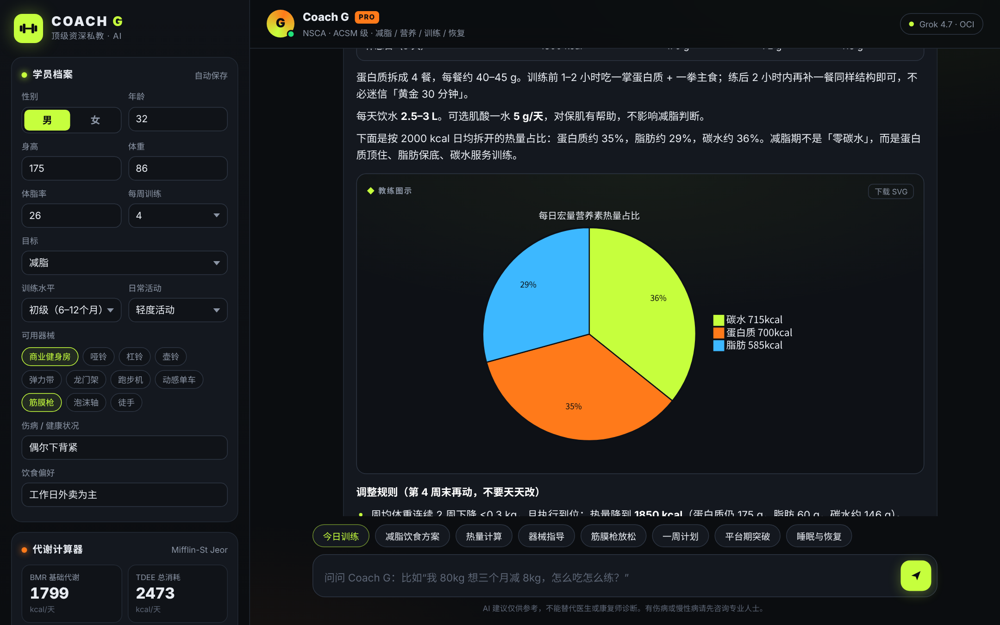

# Coach G · 顶级 AI 私人健身教练（OCI Grok 4.7）




一个本地运行的网页应用：后台通过你自己的 **Oracle Cloud（OCI）Generative AI** 账号调用 **xAI Grok 4.7**（模型 ID `xai.grok-4.7`），把它设定成 NSCA / ACSM 级别的资深私教。

能做什么：
- 减脂策略、热量缺口、平台期处理
- 饮食方案：BMR / TDEE 计算、三大营养素克数、中式家常/外卖示例食谱
- 训练量与饮食的配合、每日课表（组数 × 次数、RPE、组间休息）、一周计划
- 器械使用与动作要领、常见错误
- 放松恢复：筋膜枪部位 / 枪头 / 档位 / 时长 / 禁忌、拉伸、睡眠
- 需要时自动画图示（Mermaid 饼图/流程图/甘特图，或 SVG 人体部位示意），可一键下载 SVG
- 学员档案（身高、体重、年龄、性别、目标、水平、器械、伤病…）会自动作为上下文发送
- 内置 Mifflin-St Jeor 代谢计算器（在浏览器本地计算）
- 对话记录和档案只保存在你浏览器的 localStorage 里；OCI 密钥只在后端读取，不会发到浏览器

> 所有 JS 库（marked、DOMPurify、mermaid）已放在 `static/vendor/`，不依赖 CDN。但调用 Grok 仍需要联网。

---

## 一、准备工作

1. **Python 3.9 或更高版本**
   - Windows：到 <https://www.python.org/downloads/> 安装，安装时勾选 “Add Python to PATH”。
   - macOS：系统自带或用 `brew install python`。
2. **OCI 配置文件**（和 OCI 命令行工具用的是同一个）：
   - macOS：`~/.oci/config`
   - Windows：`C:\Users\你的用户名\.oci\config`

   内容示例（把你自己的值填进去）：
   ```ini
   [DEFAULT]
   user=ocid1.user.oc1..你的用户OCID
   fingerprint=aa:bb:cc:...你的密钥指纹
   tenancy=ocid1.tenancy.oc1..你的租户OCID
   region=us-chicago-1
   key_file=~/.oci/oci_api_key.pem
   ```
   Windows 上 `key_file` 可以写成 `C:\Users\你的用户名\.oci\oci_api_key.pem`。
   私钥 `.pem` 文件放在 `key_file` 指向的位置。**私钥不要发给任何人，也不要放进这个项目文件夹。**
3. **区域**：Grok 模型目前在 `us-chicago-1`（芝加哥）可用。配置文件里的 region 不是芝加哥的话，用下面的环境变量 `OCI_REGION=us-chicago-1` 覆盖。

---

## 二、安装并运行

### macOS（终端）
```bash
cd fitness-coach            # 解压后的文件夹
python3 -m venv .venv
source .venv/bin/activate
pip install -r requirements.txt
python app.py
```
或者直接：`bash start.sh`

### Windows（PowerShell）
```powershell
cd fitness-coach
python -m venv .venv
.\.venv\Scripts\Activate.ps1
pip install -r requirements.txt
python app.py
```
（如果 PowerShell 提示不允许运行脚本，先执行一次：`Set-ExecutionPolicy -Scope CurrentUser RemoteSigned`；
或者用命令提示符 cmd：`.venv\Scripts\activate.bat`）
或者直接双击 `start.bat`。

看到 `Uvicorn running on http://127.0.0.1:8765` 后，用浏览器打开 **http://127.0.0.1:8765** 即可。按 `Ctrl + C` 停止。

---

## 三、可选设置（环境变量）

| 变量 | 默认值 | 说明 |
|---|---|---|
| `OCI_PROFILE` | `DEFAULT` | 使用 config 里的哪个配置段 |
| `OCI_CONFIG_FILE` | `~/.oci/config` | 配置文件路径 |
| `OCI_REGION` | config 里的 region | Grok 所在区域，一般是 `us-chicago-1` |
| `OCI_COMPARTMENT_ID` | 租户 OCID | 调用模型使用的 compartment |
| `GROK_MODEL` | `xai.grok-4.7` | 也可以换成 `xai.grok-4.6` 等 |
| `PORT` | `8765` | 端口 |
| `HOST` | `127.0.0.1` | 改成 `0.0.0.0` 可让同一局域网的手机访问（注意：这样局域网内任何人都能用你的 OCI 额度） |

示例：
- macOS：`OCI_REGION=us-chicago-1 PORT=9000 python app.py`
- Windows PowerShell：`$env:OCI_REGION="us-chicago-1"; $env:PORT="9000"; python app.py`

---

## 四、常见问题

- **NotAuthenticated / 401**：检查 config 里的 user、tenancy、fingerprint 是否和上传到控制台的公钥对应，`key_file` 路径是否正确。
- **404 / 模型不存在**：确认区域是 `us-chicago-1`，并且账号已开通 Generative AI 服务。
- **回答比较慢**：Grok 4.7 会先进行推理再作答，复杂方案可能需要 1–2 分钟，界面会显示“正在深度思考”。
- **图示显示为代码**：说明模型输出的图示语法有误，原始代码会照常显示，可以让教练“重新画一下图”。

## 文件结构
```
app.py            后端（FastAPI，流式调用 OCI Grok）
prompts.py        教练系统提示词（可按需修改）
static/           前端页面（index.html / styles.css / app.js / vendor 库）
requirements.txt  Python 依赖
start.sh / start.bat  一键启动脚本
```

> 免责声明：AI 建议仅供参考，不能替代医生、营养师或康复师的诊断。有伤病、慢性病或处于孕产期，请先咨询专业人士。
